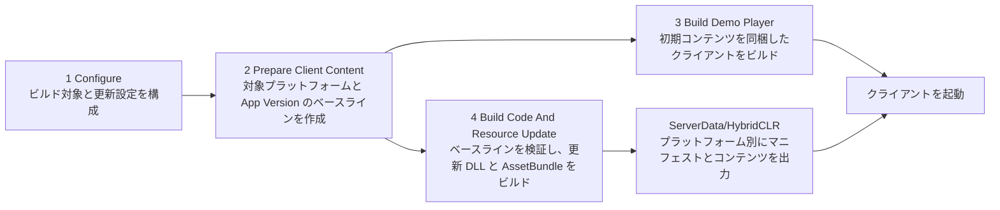
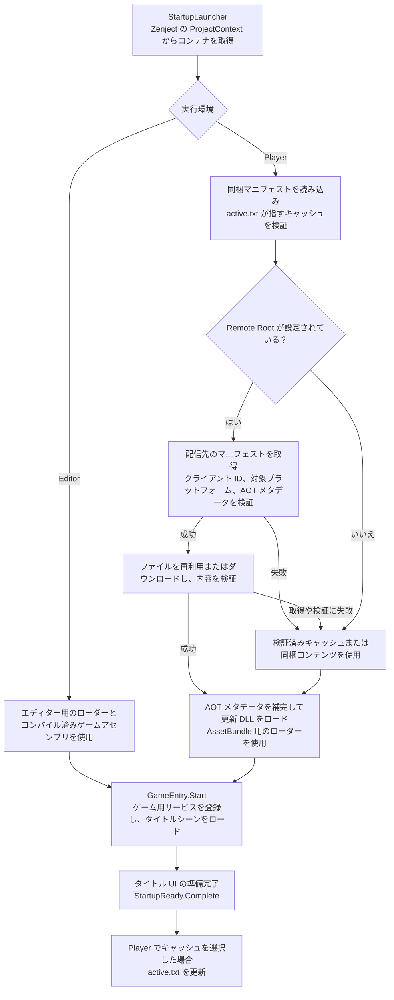
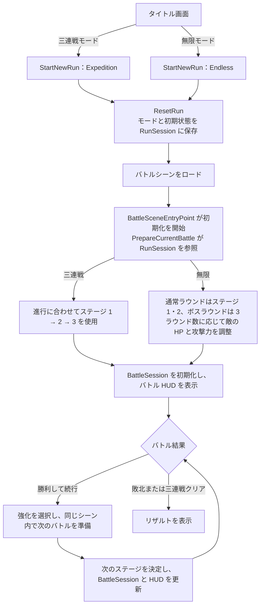
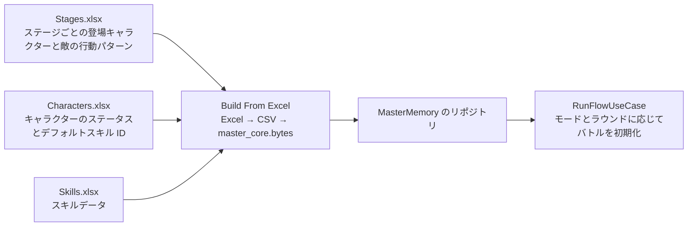

# CUBE BATTLE プロジェクトの処理フロー

## 1. クライアントのビルドと更新コンテンツの配信

> **中文对照** 第 2 步为目标平台和 App Version 建立基线。第 3 步出底包，第 4 步校验基线后生成热更 DLL 和 Bundle，并输出到 ServerData。

ベースラインはプラットフォームと App Version の組み合わせに対応します。手順 4 では、このベースラインを使って互換性を検証し、クライアントのビルド時に用意した AOT 補完メタデータを使用します。ベースライン作成時からビルド入力が変わった場合は、該当する入力を元に戻すか、App Version を上げて新しいクライアントを準備します。

## 2. クライアントの起動とコンテンツの選択

> **中文对照** Player 先建立随包或缓存候选，再查远端。远端校验失败时沿用已验证的候选。加载 AOT 元数据和热更程序集、打开标题 UI 并收到就绪信号后，才尝试提交 active.txt。

コンテンツの取得と検証が済んだ後、ゲームが起動して UI の準備完了を通知すると、起動処理は使用するキャッシュを `active.txt` に記録します。更新コンテンツでの起動に失敗した場合は、そのバージョンを拒否済みとして記録し、次回以降の起動時に同じバージョンをスキップします。

## 3. タイトル画面からバトルへ

> **中文对照** 标题按钮把模式存进共享 RunSession。两个模式进入同一战斗场景；三连战按 1、2、3 推进，无限模式在普通轮复用 1、2，Boss 轮用 3。续战在同一场景中准备。

タイトル画面で選んだモードは、共有の `RunSession` に保存されます。バトルシーンは同じ状態を参照します。エディターでバトルシーンを直接実行し、状態が `NotStarted` の場合は、`PrepareCurrentBattle` が既定の三連戦モードで開始します。

## 4. バトル用マスターデータの流れ

> **中文对照** Stages 关联玩家、敌人和攻击模式，Characters 提供属性和默认技能 ID，Skills 提供技能数据。Excel 转为 master_core.bytes，RunFlowUseCase 从仓库读取并组装本场战斗。

説明するときは、タイトル画面のモード選択から始め、`RunSession` を経てバトルが始まるまでを追うと、ゲームの進行を示せます。その後、起動フローに戻ると、クライアントが更新されたコードやリソースを取得する仕組みを説明できます。
